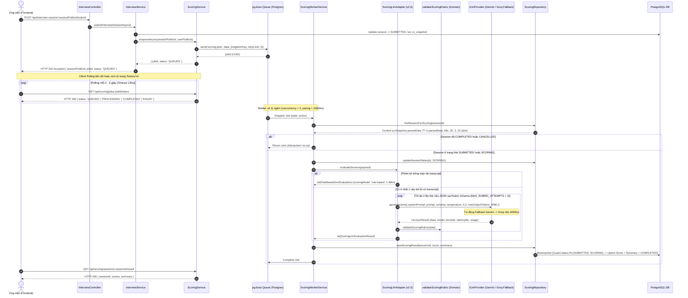

# API Contract: Background Scoring & AI Evaluation Module

Tài liệu đặc tả hợp đồng giao tiếp (API Contract) cho **Module Chấm điểm & Đánh giá Nền bằng AI (Scoring Module – Luồng 5)** trong hệ thống MockMate AI. Toàn bộ đặc tả được chuẩn hóa dựa trên 100% mã nguồn thực tế đã được triển khai, kiểm thử và đồng bộ trên nhánh `feat/scoring-ai-worker` (tích hợp với PR #34 `interview-history`, PR #35 `question-generation`, PR #36 `cv-parse` và Frontend PR #10 → PR #15).

---

## 1. Kiến trúc Tổng thể & Sơ đồ Luồng (End-to-End Workflow)

Hệ thống xử lý chấm điểm hoạt động theo kiến trúc **Bất đồng bộ (Asynchronous Queue & Worker)** dựa trên PostgreSQL và thư viện `pg-boss`. Khi thí sinh hoàn thành bài phỏng vấn, quá trình tổng hợp ngữ cảnh (`cvSnapshot` từ PR #36, `jobDescription`, `3..10` câu hỏi từ PR #35, `transcript` Web Speech API từ FE PR #14, `emotionSummary`) và chấm điểm bằng mô hình ngôn ngữ lớn (**Gemini 3.8 Flash** / **Groq GPT-OSS 120B Fallback**) được đưa vào hàng đợi nền để đảm bảo phản hồi tức thì và không bị gián đoạn kết nối HTTP.



---

## 2. Quy ước Chung Hệ thống (System Conventions)

Tất cả các endpoint trong tài liệu này tuân thủ nghiêm ngặt tiêu chuẩn chung của backend MockMate:

1. **Prefix URL**: Mọi endpoint đều sử dụng tiền tố `/api/` (ví dụ: `/api/scoring/...`, `/api/interview-session/...`).
2. **Quy tắc đặt tên (Naming Convention)**: 100% thuộc tính dùng định dạng `camelCase`. Mốc thời gian được định dạng theo chuẩn ISO 8601 UTC string (`YYYY-MM-DDTHH:mm:ss.sssZ`). Không bao giờ lộ `id (INT)` nội bộ ra ngoài response.
3. **Phân quyền & Xác thực (Auth & Security)**:
   - Header bắt buộc: `Authorization: Bearer <access_token>`.
   - Role hỗ trợ: `USER` hoặc `ADMIN`.
   - Kiểm tra quyền sở hữu (Ownership Enforcement): Người dùng chỉ được phép truy vấn dữ liệu thuộc tài khoản của mình (`user.sub`). Tài khoản `ADMIN` có quyền xem dữ liệu của toàn bộ người dùng.
4. **Cấu trúc Envelope Phản hồi Chuẩn**:
   - **Thành công (HTTP 200 / 202)**:
     ```json
     {
       "statusCode": 200,
       "success": true,
       "data": { ... },
       "message": "Thông điệp mô tả kết quả",
       "timestamp": "2026-11-12T10:00:00.000Z"
     }
     ```
   - **Thất bại (HTTP 4xx / 5xx)**:
     ```json
     {
       "statusCode": 400,
       "success": false,
       "code": "BAD_REQUEST",
       "message": "Thông báo chi tiết nguyên nhân lỗi",
       "path": "/api/scoring/...",
       "timestamp": "2026-11-12T10:00:00.000Z"
     }
     ```

---

## 3. Điểm Nối Chuyển giao: Nộp Bài & Đẩy Hàng Đợi (Handoff Point)

Sau khi ứng viên hoàn thành trả lời các câu hỏi (`3..10` câu hỏi theo PR #35) qua Module Phỏng vấn (Luồng 3 - Hạ), ứng viên kích hoạt nộp bài. Tại thời điểm này, `InterviewService` lưu bản chụp `cv_snapshot` cố định để việc ứng viên chỉnh sửa `parsedData` (PR #36) hay xóa CV về sau không ảnh hưởng đến phiên phỏng vấn.

```http
POST /api/interview-session/:sessionPublicId/submit
Authorization: Bearer <access_token>
Content-Type: application/json
```

### Response Thành công: `HTTP 202 Accepted`
```json
{
  "statusCode": 202,
  "success": true,
  "data": {
    "sessionPublicId": "11111111-1111-4111-8111-111111111111",
    "jobId": "33333333-3333-4333-8333-333333333333",
    "status": "QUEUED"
  },
  "message": "Interview session submitted successfully",
  "timestamp": "2026-11-12T10:00:00.000Z"
}
```

> [!NOTE]
> Phía server, `InterviewService` ủy quyền đẩy job vào hàng đợi thông qua method:
> `IScoringService.enqueueAsync(sessionPublicId: string, userPublicId: string): Promise<Result<EnqueueResult, AppError>>`.

---

## 4. Đặc tả Chi tiết các Endpoints Module Scoring

### 4.1. Tra cứu Trạng thái Job trong Hàng Đợi

Tra cứu tiến độ xử lý ngầm của job chấm điểm theo `jobId` nhận được từ phản hồi submit.

```http
GET /api/scoring/jobs/:jobId/status
Authorization: Bearer <access_token>
```

#### Parameters:
| Tên tham số | Vị trí | Kiểu dữ liệu | Bắt buộc | Mô tả |
| :--- | :--- | :--- | :---: | :--- |
| `jobId` | Path | `UUID string` | Có | Định danh UUID của job trong `pg-boss` |

#### Bảng Ánh xạ Trạng thái (`ScoringJobStatus`):
| Trạng thái Job | Trạng thái Session DB (`SessionStatus`) | Diễn giải trạng thái cho Frontend |
| :--- | :--- | :--- |
| `QUEUED` | `SUBMITTED` | Job đang xếp hàng trong hàng đợi, chờ worker nhận. |
| `PROCESSING` | `SCORING` | Worker đang đọc ngữ cảnh, xây dựng prompt `v2.0` và gọi AI đánh giá. |
| `COMPLETED` | `COMPLETED` | Quá trình chấm điểm hoàn tất, điểm số và nhận xét đã lưu atomic vào CSDL. |
| `FAILED` | `FAILED` | Job gặp lỗi Non-Retryable (`BadRequest`/Validation) hoặc vượt quá số lần retry (3 lần). |

#### Phản hồi Thành công: `HTTP 200 OK`
```json
{
  "statusCode": 200,
  "success": true,
  "data": {
    "jobId": "33333333-3333-4333-8333-333333333333",
    "sessionId": "11111111-1111-4111-8111-111111111111",
    "status": "COMPLETED",
    "createdAt": "2026-11-12T10:00:01.120Z",
    "completedAt": "2026-11-12T10:00:18.450Z"
  },
  "message": "Job status retrieved successfully",
  "timestamp": "2026-11-12T10:00:18.500Z"
}
```

#### Các Mã Lỗi Thường gặp:
| HTTP Status | Error Code | Message trong Code | Nguyên nhân & Hướng xử lý |
| :---: | :--- | :--- | :--- |
| **400** | `BAD_REQUEST` | `Request validation failed` | Định dạng `jobId` không hợp lệ (`ParseUUIDPipe`). |
| **401** | `UNAUTHORIZED` | `Unauthorized` | Thiếu access token hoặc token đã hết hạn / không hợp lệ. |
| **403** | `FORBIDDEN` | `You are not authorized to view this scoring job` | Job này thuộc về người dùng khác (`job.data.userId !== user.sub`). |
| **404** | `NOT_FOUND` | `Scoring job with id '...' not found` | Không tìm thấy job trong hàng đợi (hoặc job đã bị dọn sau 7 ngày). |

---

### 4.2. Lấy Kết Quả Chấm Điểm & Nhận Xét Chi Tiết

Sau khi trạng thái phiên chuyển sang `COMPLETED`, ứng viên (hoặc trang lịch sử chi tiết `/history/:id` – `HistoryResultPanel.tsx` của Frontend PR #10) gọi endpoint này để nhận toàn bộ bảng điểm rubric và phân tích nhận xét AI.

```http
GET /api/scoring/sessions/:sessionId/result
Authorization: Bearer <access_token>
```

#### Parameters:
| Tên tham số | Vị trí | Kiểu dữ liệu | Bắt buộc | Mô tả |
| :--- | :--- | :--- | :---: | :--- |
| `sessionId` | Path | `UUID string` | Có | Định danh UUID của phiên phỏng vấn (`sessionPublicId`) |

#### Phản hồi Thành công: `HTTP 200 OK`
```json
{
  "statusCode": 200,
  "success": true,
  "data": {
    "sessionId": "11111111-1111-4111-8111-111111111111",
    "scores": {
      "publicId": "77777777-7777-4777-8777-777777777777",
      "contentScore": 8.5,
      "relevanceScore": 8.0,
      "confidenceScore": 7.5,
      "overallScore": 8.1,
      "scoredAt": "2026-11-12T10:00:18.450Z"
    },
    "summary": {
      "publicId": "88888888-8888-4888-8888-888888888888",
      "overallFeedback": "Ứng viên thể hiện nền tảng kỹ thuật vững vàng, trả lời đúng trọng tâm câu hỏi về NestJS và PostgreSQL. Tư duy phân tích bài toán logic, phong thái tự tin và chuyên nghiệp.",
      "strengths": [
        {
          "category": "TECHNICAL_KNOWLEDGE",
          "title": "Nắm vững kiến thức chuyên sâu về TypeScript & NestJS",
          "description": "Giải thích chính xác cơ chế Dependency Injection, B-Tree index và khóa bản ghi trong transaction."
        },
        {
          "category": "PROBLEM_SOLVING",
          "title": "Tư duy tối ưu hóa hiệu năng tốt",
          "description": "Nêu rõ quy trình khoanh vùng truy vấn chậm và đánh giá độ chọn lọc của index."
        }
      ],
      "improvements": [
        {
          "category": "COMMUNICATION",
          "title": "Bổ sung số liệu đo lường kết quả thực tế",
          "description": "Một số câu trả lời tình huống chưa nêu rõ chỉ số cải thiện trước và sau khi tối ưu.",
          "suggestion": "Áp dụng mô hình STAR (Situation - Task - Action - Result) kèm số liệu định lượng cụ thể."
        }
      ],
      "scoringModel": "gemini-3.8-flash",
      "promptVersion": "v2.0",
      "generatedAt": "2026-11-12T10:00:18.450Z"
    }
  },
  "message": "Scoring result retrieved successfully",
  "timestamp": "2026-11-12T10:00:19.000Z"
}
```

> [!TIP]
> **Công thức tính Điểm Tổng kết (`overallScore`) cố định tại Server**:
> `overallScore = Number((contentScore * 0.4 + relevanceScore * 0.4 + confidenceScore * 0.2).toFixed(1))`.
> Tỷ trọng: Chất lượng nội dung (`40%`), Độ phù hợp câu hỏi & CV/JD (`40%`), Phong thái & Sự tự tin (`20%`).

#### Danh mục `FeedbackCategory` Chuẩn (6 giá trị):
Mọi phần tử trong `summary.strengths` và `summary.improvements` (tối đa `5` mục mỗi danh sách) đều được chuẩn hóa về 1 trong 6 giá trị `FeedbackCategory`:
- `TECHNICAL_KNOWLEDGE`
- `PROBLEM_SOLVING`
- `RELEVANCE`
- `COMMUNICATION` (mặc định khi LLM trả danh mục ngoài tập chuẩn)
- `CONFIDENCE`
- `EXPERIENCE`

#### Các Mã Lỗi Thường gặp:
| HTTP Status | Error Code | Message trong Code | Nguyên nhân & Hướng xử lý |
| :---: | :--- | :--- | :--- |
| **400** | `BAD_REQUEST` | `Session scoring is not completed (current status: SCORING)` | Phiên phỏng vấn chưa hoàn tất chấm điểm (`session.status !== 'COMPLETED'`). |
| **400** | `BAD_REQUEST` | `Request validation failed` | Định dạng `sessionId` không phải chuẩn UUID. |
| **401** | `UNAUTHORIZED` | `Unauthorized` | Không có token hoặc token không hợp lệ / hết hạn. |
| **403** | `FORBIDDEN` | `You are not authorized to view the result of this session` | Phiên phỏng vấn thuộc về người dùng khác. |
| **404** | `NOT_FOUND` | `Interview session with id '...' not found` | Không tìm thấy session trong CSDL. |
| **404** | `NOT_FOUND` | `Scoring result for session '...' not found` | Session tồn tại nhưng chưa có bản ghi điểm / summary. |

---

## 5. Đặc tả Rubric AI `v2.0`, Chuẩn hóa Dữ liệu & Xử lý Trường hợp Biên

### 5.1. Đồng bộ Thang Điểm với Giao diện `HistoryResultPanel` (Frontend PR #10)
Prompt hệ thống (`SCORING_PROMPT_VERSION = 'v2.0'`) định nghĩa rõ 3 ngưỡng điểm đồng bộ với hàm `scoreTone(score)` trên giao diện kết quả:
- **`0.0 – 4.9` (Yếu / Đỏ)**: Kiến thức sai lệch hoặc bỏ trống nhiều câu, lạc đề, diễn đạt rời rạc.
- **`5.0 – 7.9` (Đạt – Khá / Cần cải thiện / Vàng)**: Nắm được ý cơ bản nhưng thiếu chiều sâu thực chiến hoặc thiếu dẫn chứng cụ thể theo mô hình STAR.
- **`8.0 – 10.0` (Tốt – Xuất sắc / Xanh)**: Chính xác, sâu sắc, bám sát CV/JD và độ khó câu hỏi (`EASY`/`MEDIUM`/`HARD`), cấu trúc mạch lạc, tự tin.

### 5.2. Xử lý Đặc thù Speech-to-Text (`vi-VN`) & `EmotionSummary`
- **Bản ghi `transcript` từ Web Speech API (`vi-VN` – FE PR #14)**: Prompt hướng dẫn AI chỉ chấm theo ý nghĩa chuyên môn, cấu trúc lập luận và độ mạch lạc, **không trừ điểm lỗi dấu câu hay chính tả cơ học của bộ nhận diện giọng nói**.
- **Chuẩn hóa `emotion_summary` (§4.6 & §10 Quyết định #5 Database Spec)**: Hàm `normalizeEmotionSummary` chỉ giữ đúng cấu trúc `{ dominant: string, distribution: Record<string, number> }` với nhãn cảm xúc hợp lệ và xác suất kẹp trong `[0, 1]`; tự động loại bỏ các trường ngoài quy ước như `wordsPerMinute`.
- **Làm sạch văn bản thuần (`cleanRubricPlainText`)**: Loại bỏ ký tự null `\u0000`, thẻ HTML `<...>` và ký tự định dạng Markdown (`**`, `__`, `#`, `-`) để hiển thị sạch trên các thẻ `<p>` của `HistoryResultPanel.tsx`.

### 5.3. Ngân sách Token, Chống Prompt Injection & Nhánh `rule-based`
- **Chống Prompt Injection**: Strip trực tiếp mọi thẻ đóng/mở trùng tên delimiter (`<cv_data>`, `<job_description>`, `<question_text>`, `<candidate_answer>`) trong dữ liệu người dùng.
- **Giới hạn độ dài ngữ cảnh**:
  - Khối `<cv_data>` ưu tiên đọc từ `interview_sessions.cv_snapshot.parsedData`, chỉ trích lọc `summary`, `skills`, tối đa `5` `experiences` và `5` `projects` (`<= 6.000` ký tự).
  - Khối `<job_description>` giới hạn `<= 3.000` ký tự.
  - Mỗi câu trả lời giới hạn `<= 4.000` ký tự và tổng `transcript` toàn phiên (`3..10` câu hỏi) giới hạn `<= 24.000` ký tự, cắt tại **ranh giới khoảng trắng gần nhất** kèm nhãn `... [đã rút gọn]`.
- **Phiên phỏng vấn bỏ trống (`scoringModel = 'rule-based'`)**: Khi tất cả câu hỏi đều không có `transcript` (hoặc chỉ chứa khoảng trắng), `ScoringLlmAdapter` trả kết quả tất định `0 / 0 / 0` (`overallScore: 0`, `scoringModel: 'rule-based'`, `promptVersion: 'v2.0'`) ngay lập tức mà không tốn lệnh gọi AI.

### 5.4. Cơ chế Retry Schema & Phân loại Lỗi trong Worker
1. **Retry Schema tại `ScoringLlmAdapter` (`MAX_RUBRIC_ATTEMPTS = 2`)**: Gọi `ILlmProvider.generateJson` với `temperature: 0.2`, `maxOutputTokens: 4096`. Nếu JSON trả về không vượt qua `validateScoringRubric` (ví dụ điểm `NaN`, thiếu trường bắt buộc), adapter tự động thử lại tối đa `1` lần nữa trước khi trả `AppError(ErrorCode.InternalServerError)`.
2. **Phân loại lỗi tại `ScoringWorkerService`**:
   - **Non-Retryable (`AppError(BadRequest)` / `ScoringDomainErrorValidation`)**: Gọi `markSessionFailed` chuyển phiên sang `FAILED` ngay ở lần thử đầu (`retryCount = 0`) để giao diện `/history/:id` thoát trạng thái chờ ngay lập tức.
   - **Retryable (`AppError(TooManyRequests)` / `AppError(InternalServerError)` / lỗi mạng)**: Để `pg-boss` thực hiện retry theo cấu hình hàng đợi; chỉ đánh dấu `FAILED` khi lần thử cuối cùng (`retryCount + 1 >= retryLimit`) vẫn thất bại.
   - **Transaction Status Guard**: `ScoringRepository.saveScoringResult` kiểm tra `status IN (SUBMITTED, SCORING)` bằng `updateMany` ngay trong `$transaction` trước khi commit `COMPLETED`.
