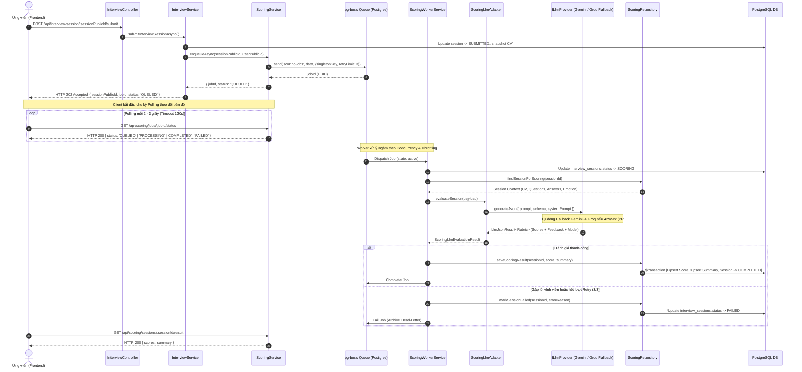

# API Contract: Background Scoring & Evaluation Module

Tài liệu đặc tả hợp đồng giao tiếp (API Contract) cho **Module Chấm điểm & Đánh giá Nền (Scoring Module)** trong hệ thống MockMate AI. Toàn bộ đặc tả được chuẩn hóa dựa trên 100% mã nguồn thực tế đã được triển khai, kiểm thử và đồng bộ trên branch `feat/scoring-queue-resilience` (kế thừa PR #23, PR #24, PR #26, PR #29, PR #30).

---

## 1. Kiến trúc Tổng thể & Sơ đồ Luồng (End-to-End Workflow)

Hệ thống xử lý chấm điểm hoạt động theo kiến trúc **Bất đồng bộ (Asynchronous Queue & Worker)** dựa trên PostgreSQL và thư viện `pg-boss`. Khi thí sinh hoàn thành bài phỏng vấn, quá trình phân tích video/transcript và chấm điểm bằng mô hình ngôn ngữ lớn (Gemini 3.8 Flash / Groq GPT-OSS Fallback) được đưa vào hàng đợi nền để đảm bảo phản hồi tức thì và không bị gián đoạn kết nối HTTP.



---

## 2. Quy ước Chung Hệ thống (System Conventions)

Tất cả các endpoint trong tài liệu này tuân thủ nghiêm ngặt tiêu chuẩn chung của backend MockMate:

1. **Prefix URL**: Mọi endpoint đều sử dụng tiền tố `/api/` (ví dụ: `/api/scoring/...`, `/api/interview-session/...`).
2. **Quy tắc đặt tên (Naming Convention)**: 100% thuộc tính dùng định dạng `camelCase`. Mốc thời gian được định dạng theo chuẩn ISO 8601 UTC string (`YYYY-MM-DDTHH:mm:ss.sssZ`).
3. **Phân quyền & Xác thực (Auth & Security)**:
   - Header bắt buộc: `Authorization: Bearer <access_token>`.
   - Role hỗ trợ: `USER` hoặc `ADMIN`.
   - Kiểm tra quyền sở hữu (Ownership Enforcement): Người dùng chỉ được phép truy vấn dữ liệu thuộc tài khoản của mình (`user.sub`). Tài khoản `ADMIN` có quyền xem dữ liệu của toàn bộ người dùng.
4. **Cấu trúc Envelope Phản hồi Chuẩn**:
   - **Thành công (HTTP 200 / 202)**:
     ```json
     {
       "statusCode": 200,
       "success": true,
       "data": { ... },
       "message": "Thông điệp mô tả kết quả",
       "timestamp": "2026-10-20T10:00:00.000Z"
     }
     ```
   - **Thất bại (HTTP 4xx / 5xx)**:
     ```json
     {
       "statusCode": 400,
       "success": false,
       "code": "BAD_REQUEST",
       "message": "Thông báo chi tiết nguyên nhân lỗi",
       "path": "/api/scoring/...",
       "timestamp": "2026-10-20T10:00:00.000Z"
     }
     ```

---

## 3. Điểm Nối Chuyển giao: Nộp Bài & Đẩy Hàng Đợi (Handoff Point)

Sau khi ứng viên hoàn thành trả lời các câu hỏi và tải video lên Cloudinary qua Module Phỏng vấn (Luồng 3 - Hạ), ứng viên kích hoạt nộp bài.

```http
POST /api/interview-session/:sessionPublicId/submit
Authorization: Bearer <access_token>
Content-Type: application/json
```

### Request Body:
```json
{
  "cvPublicId": "550e8400-e29b-41d4-a716-446655440001",
  "totalQuestions": 5,
  "durationSeconds": 620
}
```

### Response Thành công: `HTTP 202 Accepted`
```json
{
  "statusCode": 202,
  "success": true,
  "data": {
    "sessionPublicId": "11111111-1111-4111-8111-111111111111",
    "jobId": "33333333-3333-4333-8333-333333333333",
    "status": "QUEUED"
  },
  "message": "Interview session submitted successfully",
  "timestamp": "2026-10-20T10:00:00.000Z"
}
```

> [!NOTE]
> Phía server, `InterviewService` ủy quyền đẩy job vào hàng đợi thông qua method:
> `IScoringService.enqueueAsync(sessionPublicId: string, userPublicId: string): Promise<Result<EnqueueResult, AppError>>`.

---

## 4. Đặc tả Chi tiết các Endpoints Module Scoring

### 4.1. Tra cứu Trạng thái Job trong Hàng Đợi

Tra cứu tiến độ xử lý ngầm của job chấm điểm theo `jobId` nhận được từ phản hồi submit.

```http
GET /api/scoring/jobs/:jobId/status
Authorization: Bearer <access_token>
```

#### Parameters:
| Tên tham số | Vị trí | Kiểu dữ liệu | Bắt buộc | Mô tả |
| :--- | :--- | :--- | :---: | :--- |
| `jobId` | Path | `UUID string` | Có | Định danh UUID của job trong `pg-boss` |

#### Bảng Ánh xạ Trạng thái (`ScoringJobStatus`):
| Trạng thái Job | Trạng thái Session DB (`SessionStatus`) | Diễn giải trạng thái cho Frontend |
| :--- | :--- | :--- |
| `QUEUED` | `SUBMITTED` | Job đang xếp hàng trong hàng đợi, chờ worker nhận. |
| `PROCESSING` | `SCORING` | Worker đang đọc dữ liệu, phân tích transcript và gọi AI đánh giá. |
| `COMPLETED` | `COMPLETED` | Quá trình chấm điểm hoàn tất, điểm số và nhận xét đã lưu vào CSDL. |
| `FAILED` | `FAILED` | Job gặp lỗi không thể phục hồi hoặc vượt quá số lần retry (3 lần). |

#### Phản hồi Thành công: `HTTP 200 OK`
```json
{
  "statusCode": 200,
  "success": true,
  "data": {
    "jobId": "33333333-3333-4333-8333-333333333333",
    "sessionId": "11111111-1111-4111-8111-111111111111",
    "status": "COMPLETED",
    "createdAt": "2026-10-20T10:00:01.120Z",
    "completedAt": "2026-10-20T10:00:18.450Z"
  },
  "message": "Job status retrieved successfully",
  "timestamp": "2026-10-20T10:00:18.500Z"
}
```

#### Các Mã Lỗi Thường gặp:
| HTTP Status | Error Code | Message trong Code | Nguyên nhân & Hướng xử lý |
| :---: | :--- | :--- | :--- |
| **400** | `BAD_REQUEST` | `Validation failed (uuid is expected)` | Định dạng `jobId` không hợp lệ (ParseUUIDPipe). |
| **401** | `UNAUTHORIZED` | `Unauthorized` | Thiếu access token hoặc token đã hết hạn / không hợp lệ. |
| **403** | `FORBIDDEN` | `You are not authorized to view this scoring job` | Job này thuộc về người dùng khác (`job.data.userId !== user.sub`). |
| **404** | `NOT_FOUND` | `Scoring job with id '...' not found` | Không tìm thấy job trong hàng đợi (hoặc job đã bị dọn sau 7 ngày). |

##### Ví dụ Phản hồi Lỗi (HTTP 404):
```json
{
  "statusCode": 404,
  "success": false,
  "code": "NOT_FOUND",
  "message": "Scoring job with id '33333333-3333-4333-8333-333333333333' not found",
  "path": "/api/scoring/jobs/33333333-3333-4333-8333-333333333333/status",
  "timestamp": "2026-10-20T10:00:05.000Z"
}
```

---

### 4.2. Lấy Kết Quả Chấm Điểm & Nhận Xét Chi Tiết

Sau khi trạng thái job chuyển sang `COMPLETED`, ứng viên gọi endpoint này để nhận toàn bộ bảng điểm rubric và phân tích nhận xét AI.

```http
GET /api/scoring/sessions/:sessionId/result
Authorization: Bearer <access_token>
```

#### Parameters:
| Tên tham số | Vị trí | Kiểu dữ liệu | Bắt buộc | Mô tả |
| :--- | :--- | :--- | :---: | :--- |
| `sessionId` | Path | `UUID string` | Có | Định danh UUID của phiên phỏng vấn (`sessionPublicId`) |

#### Phản hồi Thành công: `HTTP 200 OK`
```json
{
  "statusCode": 200,
  "success": true,
  "data": {
    "sessionId": "11111111-1111-4111-8111-111111111111",
    "scores": {
      "publicId": "77777777-7777-4777-8777-777777777777",
      "contentScore": 8.5,
      "relevanceScore": 8.0,
      "confidenceScore": 7.5,
      "overallScore": 8.1,
      "scoredAt": "2026-10-20T10:00:18.450Z"
    },
    "summary": {
      "publicId": "88888888-8888-4888-8888-888888888888",
      "overallFeedback": "Ứng viên thể hiện nền tảng kỹ thuật vững vàng, trả lời đúng trọng tâm câu hỏi về React và TypeScript. Tư duy phân tích bài toán logic, phong thái tự tin và chuyên nghiệp.",
      "strengths": [
        {
          "category": "TECHNICAL_KNOWLEDGE",
          "title": "Nắm vững kiến thức chuyên sâu về TypeScript & React",
          "description": "Giải thích xuất sắc sự khác biệt giữa Interface và Type, cũng như cơ chế Declaration Merging."
        },
        {
          "category": "PROBLEM_SOLVING",
          "title": "Tư duy tối ưu hóa hiệu năng tốt",
          "description": "Nắm bắt chính xác cách sử dụng React.memo, useMemo và useCallback đúng ngữ cảnh tránh re-render thừa."
        }
      ],
      "improvements": [
        {
          "category": "COMMUNICATION",
          "title": "Bổ sung ví dụ thực tế từ dự án",
          "description": "Phần trình bày có xu hướng thiên về lý thuyết sách vở, chưa nêu rõ bài học kinh nghiệm cá nhân khi gặp lỗi thực tế.",
          "suggestion": "Nên sử dụng mô hình STAR (Situation - Task - Action - Result) để câu trả lời thuyết phục và sinh động hơn."
        }
      ],
      "scoringModel": "gemini-3.8-flash",
      "promptVersion": "v1.0",
      "generatedAt": "2026-10-20T10:00:18.450Z"
    }
  },
  "message": "Scoring result retrieved successfully",
  "timestamp": "2026-10-20T10:00:19.000Z"
}
```

> [!TIP]
> **Công thức tính Điểm Tổng kết (`overallScore`)**:
> `overallScore = Math.round((contentScore * 0.4 + relevanceScore * 0.4 + confidenceScore * 0.2) * 10) / 10`.
> Tỷ trọng: Chất lượng nội dung (40%), Độ phù hợp câu hỏi (40%), Phong thái & Sự tự tin (20%).

#### Các Mã Lỗi Thường gặp:
| HTTP Status | Error Code | Message trong Code | Nguyên nhân & Hướng xử lý |
| :---: | :--- | :--- | :--- |
| **400** | `BAD_REQUEST` | `Session scoring is not completed (current status: SCORING)` | Phiên phỏng vấn chưa hoàn tất chấm điểm (`session.status !== 'COMPLETED'`). |
| **400** | `BAD_REQUEST` | `Validation failed (uuid is expected)` | Định dạng `sessionId` không phải chuẩn UUIDv4. |
| **401** | `UNAUTHORIZED` | `Unauthorized` | Không có token hoặc token không hợp lệ / hết hạn. |
| **403** | `FORBIDDEN` | `You are not authorized to view the result of this session` | Phiên phỏng vấn thuộc về người dùng khác. |
| **404** | `NOT_FOUND` | `Interview session with id '...' not found` | Không tìm thấy session trong CSDL. |
| **404** | `NOT_FOUND` | `Scoring result for session '...' not found` | Session tồn tại nhưng chưa có bản ghi điểm / summary. |

##### Ví dụ Phản hồi Lỗi khi Session Chưa Chấm Xong (HTTP 400):
```json
{
  "statusCode": 400,
  "success": false,
  "code": "BAD_REQUEST",
  "message": "Session scoring is not completed (current status: SCORING)",
  "path": "/api/scoring/sessions/11111111-1111-4111-8111-111111111111/result",
  "timestamp": "2026-10-20T10:00:05.000Z"
}
```

---

## 5. Hướng dẫn Tích hợp Phía Client (Frontend Integration Guide)

Để mang lại trải nghiệm người dùng tối ưu, Frontend (React / Next.js) nên triển khai cơ chế **Polling với Exponential Backoff & Timeout** theo hướng dẫn chuẩn sau:

### 5.1. Quy trình Thực thi Khuyến nghị
1. **Sau khi submit**: Nhận `jobId` và `sessionPublicId` từ `POST /api/interview-session/:sessionPublicId/submit`. Chuyển sang màn hình "Đang phân tích bài phỏng vấn".
2. **Khởi tạo Polling**:
   - Tần suất: Gọi `GET /api/scoring/jobs/:jobId/status` mỗi **2.5 giây**.
   - Giới hạn: Tối đa **48 lần thử** (tổng thời gian chờ tối đa 120 giây).
3. **Xử lý Chuyển trạng thái**:
   - Nếu `status === 'PROCESSING'`: Cập nhật thanh tiến trình (progress bar: 30% -> 70%).
   - Nếu `status === 'COMPLETED'`: Hủy polling, kích hoạt gọi ngay `GET /api/scoring/sessions/:sessionId/result` và hiển thị màn hình kết quả (Radar Chart + Feedback List).
   - Nếu `status === 'FAILED'`: Dừng polling, hiển thị thông báo thân thiện: *"Hệ thống đang gặp sự cố khi chấm điểm tự động. Vui lòng thử yêu cầu chấm lại hoặc liên hệ hỗ trợ viên."*

### 5.2. Đoạn mã Mẫu Frontend (TypeScript / Fetch API)

```typescript
interface EnqueueData {
  sessionPublicId: string;
  jobId: string;
  status: string;
}

interface ScoringResultResponse {
  sessionId: string;
  scores: {
    contentScore: number;
    relevanceScore: number;
    confidenceScore: number;
    overallScore: number;
    scoredAt: string;
  };
  summary: {
    overallFeedback: string;
    strengths: Array<{ category: string; title: string; description: string }>;
    improvements: Array<{ category: string; title: string; description: string; suggestion?: string }>;
    scoringModel: string;
  };
}

export async function pollScoringResult(
  jobId: string,
  sessionId: string,
  token: string,
  onStatusChange?: (status: string) => void,
): Promise<ScoringResultResponse> {
  const POLLING_INTERVAL_MS = 2500;
  const MAX_ATTEMPTS = 48; // 120 seconds timeout

  for (let attempt = 1; attempt <= MAX_ATTEMPTS; attempt++) {
    const statusRes = await fetch(`/api/scoring/jobs/${jobId}/status`, {
      headers: { Authorization: `Bearer ${token}` },
    });

    if (!statusRes.ok) {
      throw new Error(`Failed to check job status: HTTP ${statusRes.status}`);
    }

    const { data: jobInfo } = await statusRes.json();
    if (onStatusChange) onStatusChange(jobInfo.status);

    if (jobInfo.status === 'COMPLETED') {
      const resultRes = await fetch(`/api/scoring/sessions/${sessionId}/result`, {
        headers: { Authorization: `Bearer ${token}` },
      });
      if (!resultRes.ok) throw new Error('Failed to fetch scoring results');
      const { data: resultData } = await resultRes.json();
      return resultData;
    }

    if (jobInfo.status === 'FAILED') {
      throw new Error('Interview scoring job failed permanently.');
    }

    await new Promise((resolve) => setTimeout(resolve, POLLING_INTERVAL_MS));
  }

  throw new Error('Scoring job polling timed out after 120 seconds.');
}
```

---

## 6. Tích hợp Tầng AI LLM Provider Đa Nhà Cung Cấp (Multi-Vendor Architecture)

Theo kiến trúc từ PR #29, hạ tầng AI tích hợp cơ chế **High Availability Fallback**:
- **Primary Provider**: **Google Gemini** (`gemini-3.8-flash` qua thư viện chính thức `@google/genai`).
- **Fallback Provider**: **Groq** (`openai/gpt-oss-120b` qua `groq-sdk`).

### Cơ chế Hoạt động trong Worker:
1. `ScoringWorkerService` ủy quyền toàn bộ việc đánh giá phiên phỏng vấn cho lớp `ScoringLlmAdapter` (triển khai interface `IScoringLlmProvider`).
2. `ScoringLlmAdapter` chuẩn bị dữ liệu ngữ cảnh (CV của thí sinh, nội dung câu hỏi, bản ghi câu trả lời, chỉ số phong thái) và gọi `ILlmProvider.generateJson<ScoringRubricRawResponse>()`.
3. Nếu Gemini gặp sự cố (Rate Limit 429, Timeout, 503 Service Unavailable), `FallbackLlmProvider` tự động chuyển đổi sang Groq mà không làm gián đoạn worker.
4. Model thực tế phản hồi (`result.model`, ví dụ: `gemini-3.8-flash` hoặc `openai/gpt-oss-120b`) được lưu trữ trực tiếp vào cột `interview_summaries.scoring_model` trong CSDL PostgreSQL, đảm bảo tính minh bạch và truy xuất nguồn gốc đánh giá.
